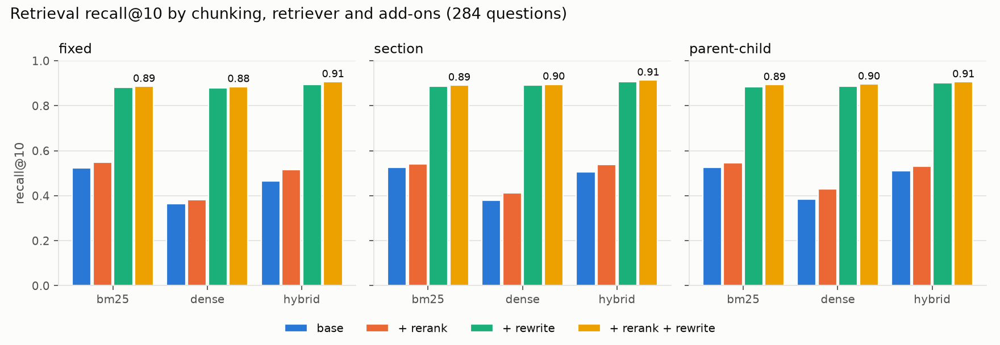
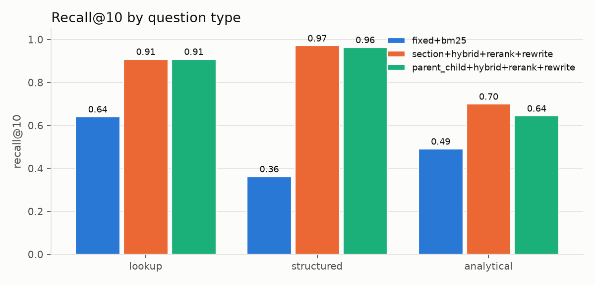

# Results: what actually improved retrieval on messy NTSB reports

All numbers are from real runs on this machine (Ryzen 7 7800X3D, CPU only, no GPU), produced by
`pc eval run --config experiments/*.yaml`; raw per-question rows live in `benchmark/runs/`.

**Headline:** the gain came from turning the question into structured filters, not from
chunking or rerankers. Recall@10 went from **0.523** (fixed-size chunks + BM25) to **0.913**
(section-aware chunks + hybrid + cross-encoder rerank + LLM query rewrite). Rewriting alone
contributed +0.36 to +0.51 in every chunking/retriever combination. Chunking strategy moved
recall by at most 0.04.

## Setup

| | |
|---|---|
| Corpus | NTSB events dated 2018-01-01 to 2026-09-30 that have text: 11,179 events |
| Chunks | fixed 45,831 · section-aware 48,886 · parent-child 84,582 children (29,149 parents) |
| Embeddings | `snowflake/snowflake-arctic-embed-xs` (384-d, fastembed/ONNX, CPU); 179,299 vectors |
| Vector index | pgvector 0.8.7 HNSW (m=16, ef_construction=64), one partial index per strategy, iterative scans for filtered queries |
| BM25 | real Okapi BM25 (bm25s, k1=1.5, b=0.75, English stemming + stopwords), not Postgres `ts_rank` |
| Hybrid | reciprocal rank fusion, k=60, over the top 100 of each retriever |
| Reranker | `Xenova/ms-marco-MiniLM-L-6-v2` cross-encoder over the top 20 fused chunks |
| Rewrite | claude-sonnet-5-5 turns each question into a pydantic-validated `QueryPlan` (years, aircraft category, FAR part, phase, injury severity, state, IMC/VMC, night, make, plus a text query); 25 questions per call |
| Benchmark | 289 questions (153 lookup, 106 structured, 30 analytical incl. 5 unanswerable); see `benchmark/DATASHEET.md` |

**Why the corpus starts in 2018.** Embedding all three strategies over 2008-2026 means about
560k chunks. At the measured 35-110 chunks/s that is a 4.5-hour CPU job, and a first attempt
was killed by memory pressure from other workloads. The brief allowed a subset when the full
embed would take over 45 minutes, so the corpus is every event from 2018 on, for all
strategies and all retrievers (BM25 included), and the benchmark is built only from that
corpus. `pc index chunk` takes the cut-off as `CORPUS_SINCE`.

### Timings

| step | wall clock |
|---|---|
| Chunking, all three strategies (2008+, before the cut) | 2 min 32 s |
| Embedding fixed (136,801 chunks, before the cut) | 46 min 22 s (49 chunks/s) |
| Embedding section, last 10,315 chunks | 3 min 37 s (48 chunks/s) |
| Embedding parent-child children (84,582 × ~93 words) | 12 min 41 s (111 chunks/s) |
| Estimated cost to embed the 2018+ corpus from scratch | ~45 min |
| HNSW builds | 11 s (section), 22 s (parent-child) |
| BM25 builds | 4-5 s per strategy |
| Full retrieval grid: 36 configs × 284 answerable questions | 12 min 47 s |

Per-query retrieval latency (cold cache, p50): BM25 3 ms; dense 10 ms (including the query
embedding); hybrid 8 ms; adding the reranker 335 ms (fixed and section chunks) or 174 ms
(shorter parent-child children). Grid rows for later rerank configs look faster because
cross-encoder scores are cached per (query, chunk) within a run. Live generation averaged
**3.6-3.9 s per claude -p call**.

## Retrieval: the full grid

Recall@10 (capped; see the datasheet), all 284 answerable questions:

| chunking | retrieval | base | + rerank | + rewrite | + rerank + rewrite |
|---|---|---:|---:|---:|---:|
| fixed | bm25 | 0.523 | 0.550 | 0.881 | 0.886 |
| fixed | dense | 0.365 | 0.383 | 0.879 | 0.885 |
| fixed | hybrid | 0.465 | 0.517 | 0.895 | 0.906 |
| section | bm25 | 0.525 | 0.542 | 0.886 | 0.891 |
| section | dense | 0.381 | 0.412 | 0.893 | 0.895 |
| section | hybrid | 0.506 | 0.539 | 0.906 | **0.913** |
| parent_child | bm25 | 0.526 | 0.547 | 0.885 | 0.893 |
| parent_child | dense | 0.385 | 0.431 | 0.886 | 0.896 |
| parent_child | hybrid | 0.510 | 0.532 | 0.902 | 0.906 |

MRR:

| chunking | retrieval | base | + rerank | + rewrite | + rerank + rewrite |
|---|---|---:|---:|---:|---:|
| fixed | bm25 | 0.488 | 0.549 | 0.838 | 0.852 |
| fixed | dense | 0.334 | 0.408 | 0.822 | 0.857 |
| fixed | hybrid | 0.422 | 0.522 | 0.841 | 0.863 |
| section | bm25 | 0.498 | 0.549 | 0.844 | 0.852 |
| section | dense | 0.345 | 0.441 | 0.817 | 0.854 |
| section | hybrid | 0.449 | 0.539 | 0.848 | 0.858 |
| parent_child | bm25 | 0.497 | 0.544 | 0.847 | 0.860 |
| parent_child | dense | 0.344 | 0.447 | 0.818 | 0.861 |
| parent_child | hybrid | 0.466 | 0.536 | 0.851 | **0.865** |



Top configurations, with recall broken down by question type:

| config | R@5 | R@10 | R@20 | MRR | nDCG@10 | lookup R@10 | structured R@10 | analytical R@10 |
|---|---:|---:|---:|---:|---:|---:|---:|---:|
| section+hybrid+rerank+rewrite | 0.888 | 0.913 | 0.919 | 0.858 | 0.861 | 0.908 | 0.971 | 0.700 |
| fixed+hybrid+rerank+rewrite | 0.891 | 0.906 | 0.913 | 0.863 | 0.859 | 0.902 | 0.967 | 0.674 |
| section+hybrid+rewrite | 0.874 | 0.906 | 0.919 | 0.848 | 0.849 | 0.902 | 0.968 | 0.666 |
| parent_child+hybrid+rerank+rewrite | 0.888 | 0.906 | 0.914 | 0.865 | 0.860 | 0.908 | 0.963 | 0.645 |
| parent_child+hybrid+rewrite | 0.883 | 0.902 | 0.914 | 0.851 | 0.850 | 0.902 | 0.963 | 0.637 |
| section+bm25+rerank+rewrite | 0.873 | 0.891 | 0.902 | 0.852 | 0.846 | 0.889 | 0.938 | 0.710 |
| fixed+bm25 (baseline) | - | 0.523 | - | 0.488 | - | 0.641 | 0.362 | 0.491 |



### What helped, what didn't

1. **Query rewriting into structured filters is the whole story for structured questions**
   (recall@10 0.36 to 0.97). "How many fatal Part 121 accidents were there in 2018?" has no
   good lexical or semantic match in any narrative; as a filter it is exact. It also lifted
   lookup questions (0.64 to 0.91), because those name a year, a state and a make.
2. **Rewriting has a failure mode, and it's measurable.** For 12 of 153 lookup questions
   (7.8%) the extracted filters exclude the right event, mostly through the *phase* filter:
   the question says "on approach", but the NTSB coded the defining event in the landing
   phase. Filters are hard constraints, so these become unrecoverable misses. A softer design
   would use filters to boost rather than exclude, or drop the phase filter when the result
   set is small.
3. **Dense retrieval alone is the weakest retriever** (0.37-0.39 base). These questions are
   entity-heavy (aircraft models, towns, years), which favours BM25, and arctic-embed-xs is a
   small model. Dense retrieval is competitive only once filters have narrowed the candidates.
   It does help **analytical** questions (themes such as "why do pilots land gear-up"): hybrid
   beats BM25 there (0.58 vs 0.50 base for section chunks).
4. **The cross-encoder helps a little, and most when ranking is weak.** It adds +0.02 to +0.05
   recall@10 without rewrite and +0.004 to +0.011 with it. It mainly improves MRR (+0.01 to
   +0.10). The cost is 170-340 ms per query on CPU.
5. **Chunking barely matters for retrieval** (spread ≤ 0.04 in any column). Section-aware
   chunks win the top spot and the analytical column; parent-child has the best MRR. Event-level
   recall is forgiving: any chunk of the right event counts.

## End to end: answers, citations, refusals

Three configurations (the fixed+BM25 baseline and the two best grid configs by recall@10,
with MRR as the tie-break) were run on a 26-question stratified subset: 13 lookup, 8
structured, and 5 analytical, of which 2 are unanswerable. **The subset was shrunk from the
planned ~60 to fit a hard budget of 130 claude -p calls.** With n = 26, one question is 3.8
points, so differences under about 10 points are noise.

| | fixed+bm25 (baseline) | section+hybrid+rerank+rewrite | parent_child+hybrid+rerank+rewrite |
|---|---:|---:|---:|
| answer correct (judge) | 0.462 (12/26) | **0.615 (16/26)** | 0.577 (15/26) |
| lookup / structured / analytical | 0.38 / 0.38 / 0.80 | 0.62 / 0.38 / 1.00 | 0.54 / 0.38 / 1.00 |
| retrieval recall@10 on this subset | 0.535 | 0.758 | 0.758 |
| refused | 46% (10 of 24 answerable) | 42% (9 of 24) | 42% (9 of 24) |
| unanswerable correctly refused | 2/2 | 2/2 | 2/2 |
| citation validity (cited chunk was retrieved) | 1.000 | 1.000 | 1.000 |
| citation precision (valid and supported) | 0.887 | 0.782 | 0.745 |
| sentences supported by their citations | 0.798 | 0.737 | 0.705 |
| citations pointing at a gold event | 0.683 | 0.969 | 0.989 |
| generation calls | 25 | 25 | 24 |
| cost per question (API-equivalent, from `claude -p`) | $0.020 | $0.016 | $0.018 |

Citation metrics are averaged over every generated answer, including drafts the verifier
withheld (15, 18 and 18 answers).

**Reading it honestly:**

- **Better retrieval became better answers mainly for lookup questions** (0.38 to 0.62).
  For structured count questions, retrieval was nearly perfect but the answers were not
  (0.38 in every config). The
  generator sees 8 chunks, often from just a few events, so it reports "one accident among
  the excerpts" when the filter matched six. Count questions should be answered from SQL over
  the filter set, not by counting excerpts; that is the obvious next change.
- **The system refuses a lot**, 38-42% of answerable questions. Most refusals are the
  model's own "insufficient evidence" (6-9 per config) or the verifier withholding an answer
  whose sentences don't match their citations (1-3 per config). Two more come from filters
  that matched no events. That is the intended bias for a "refuse when evidence
  is insufficient" product, but it caps correctness. Both unanswerable questions were refused
  in every configuration.
- **Bigger context weakens lexical grounding.** Both rewrite configs pack richer context
  (section chunks, or parent-child's 600-word parents), and the model paraphrases more, so the
  share of lexically supported sentences drops (0.74 and 0.71, against 0.80 for the
  baseline's 200-word chunks). Their citations point at the right event far more often (0.97
  and 0.99, against 0.68).
- **No citation was fabricated:** in all three configs, 100% of citations named a chunk that
  was actually retrieved and shown to the model.

### Judge calibration

The judge (claude-sonnet-5-5, 15 answers per call) was checked against my own hand labels on
every answer it graded: 44 answers across the three configs. That is every judged item; the
other answers were decided by rule (refused or unanswerable).

| | |
|---|---|
| agreement | 43/44 = 97.7% |
| Cohen's kappa | 0.910 |
| human / judge "correct" rate | 0.864 / 0.841 |

The single disagreement (baseline L034): the answer named high density altitude reducing climb
performance, which is the reference's main cause, but omitted the gusts and pilot
inexperience. I counted that as correct; the judge did not. The judge is slightly stricter
than I am. Labels and notes are in `benchmark/human_labels.jsonl`; reproduce with
`pc eval calibrate`.

## Three bugs the benchmark caught

1. **Rewrite leaking into "rewrite off".** The first grid and baseline run passed the
   LLM-rewritten text query to every retriever, even when rewrite was off. The tell was an
   API request that missed the LLM cache for a question the baseline had already answered.
   Fixed, covered by a unit test, and everything re-run. The numbers above are from the fixed
   code.
2. **The verifier punished paragraph-level citations.** The model often cites once at the end
   of a paragraph, and the first verifier rejected the uncited sentences before that citation,
   withholding correct answers (baseline correctness 0.425 then). Uncited sentences now borrow
   the next citation in the same paragraph, are still checked lexically against that text,
   and are flagged `inherited`.
3. **The sentence splitter dropped citations placed after the period** ("...stall. [key]
   Then..."), which turned cited sentences into uncited ones. Found by the verifier's unit
   test; fixed, and the verification and judging were re-run on the cached generations
   (2 more judge calls). The table above is after the fix; before it, the two rewrite configs
   scored 0.538 and 0.462.

## Refusal threshold

Before generation, a query is refused if the best cosine similarity between the query and the
context chunks is below **0.66**, unless structured filters selected the events. On a sample,
unanswerable questions scored 0.59-0.72 and answerable ones 0.65-0.85, so the gate only
catches the clearly off-topic cases; the model's own insufficient-evidence flag and the
verifier do the rest. The filtered-retrieval exemption was added after "how many fatal Part
121 accidents" kept failing the similarity gate, despite the filter returning exactly the
right events.

## LLM usage

The 120 calls made under the cap used `claude-sonnet-5-5`, and each is logged with its model in
`benchmark/llm-cache/calls.jsonl`. The 29 earlier calls (question generation and query rewriting)
ran before the backend pinned a model and before the log existed, so they used the CLI's default
model, which wasn't recorded. The backend now always passes `--model claude-sonnet-5-5`. All responses are cached in `benchmark/llm-cache/`,
and every live call is appended to `benchmark/llm-cache/calls.jsonl` and checked against a
hard cap (`PC_LLM_MAX_CALLS`, default 130).

| purpose | calls |
|---|---:|
| lookup question generation (incl. 4 from a run cut off by a usage limit, and repairs) | 17 |
| query rewriting for all 289 questions | 12 |
| answer generation (incl. 38 superseded by the rewrite-leak fix) | 109 |
| judge (incl. 8 superseded by the bug fixes) | 11 |
| **total** | **149** (120 of them under the 130-call cap) |

## Reproduce

```bash
uv run pc index chunk && uv run pc index embed && uv run pc index build
uv run pc bench lookup && uv run pc bench structured && uv run pc bench assemble
uv run pc bench rewrite
uv run pc eval run --config experiments/retrieval-grid.yaml
uv run pc eval run --config experiments/end-to-end-baseline.yaml
uv run pc eval run --config experiments/end-to-end-best.yaml
uv run pc eval calibrate && uv run pc eval report
```

With the committed LLM cache, every step after indexing replays without calling a model; set
`PC_LLM_OFFLINE=1` to make that a hard guarantee.
